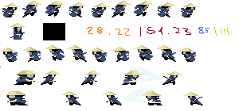
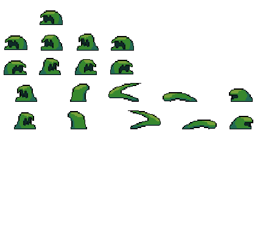
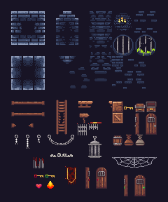

# Keyless

A pixel-art samurai platformer I made with C++ and SFML. I also drew the character, slime and level sprites myself.

## Gameplay

You play as a samurai exploring a dark level. The goal is to find three keys and open the locked passages to reach the end. Some parts of the map can only be reached after collecting the previous key.

- Run, jump and climb ladders to get around the map.
- Fight slimes with your sword. They move towards you and can hurt you if you get too close.
- Avoid spikes and watch your health bar.
- Break bonus blocks to get a random pickup: full health or stronger sword attacks for 60 seconds.
- When you finish, the game shows your time, defeated enemies and collected keys. You can also restart after dying.

## Pixel art

I drew the sprites and their animation frames for this game. The samurai has walking and sword attack animations, and I made the environment from a small tile set.

**Samurai animations**



**Slime animations**



**Level tiles**



## Controls

| Key | Action |
| --- | --- |
| `A` / `D` or arrows | Move |
| `W` or up arrow | Climb |
| `Space` | Jump |
| Left mouse button | Attack |
| `R` | Restart |
| `Q` | Quit on the end screen |
| `Enter` | Start from the menu |

## Build

You need CMake 3.20+, a C++20 compiler and Git. CMake downloads SFML 2.6.1 during configuration.

```bash
cmake -S . -B build -DCMAKE_BUILD_TYPE=Release
cmake --build build --config Release
```

Run `Keyless` from the build directory. Game assets are copied there automatically.

## Tests

Tests for collision and combat calculations can run without opening a game window:

```bash
cmake -S . -B build-tests -DKEYLESS_BUILD_GAME=OFF
cmake --build build-tests
ctest --test-dir build-tests --output-on-failure
```

